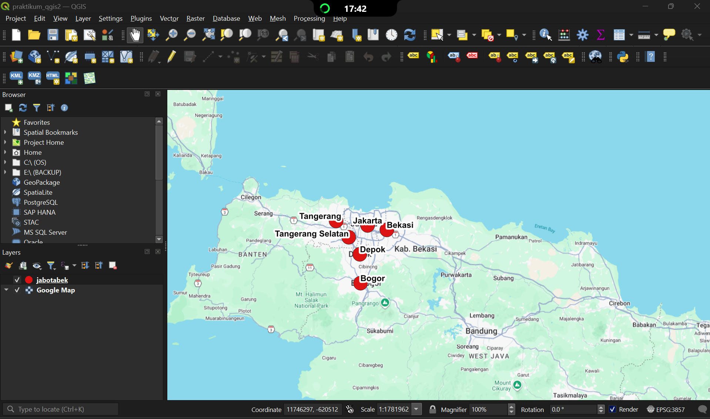
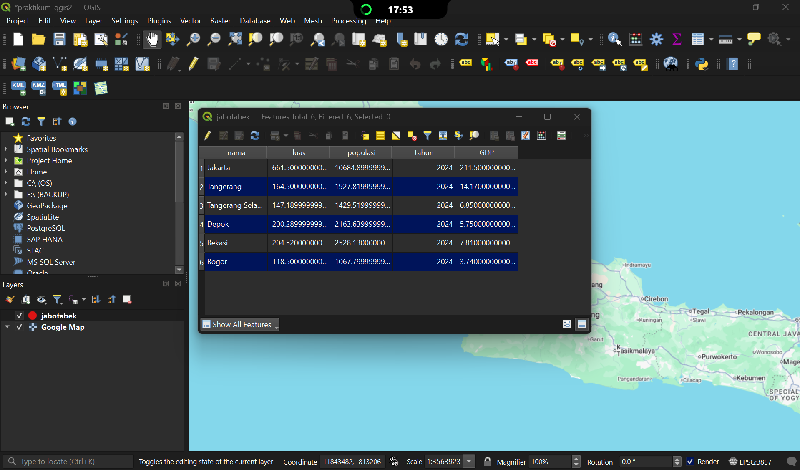
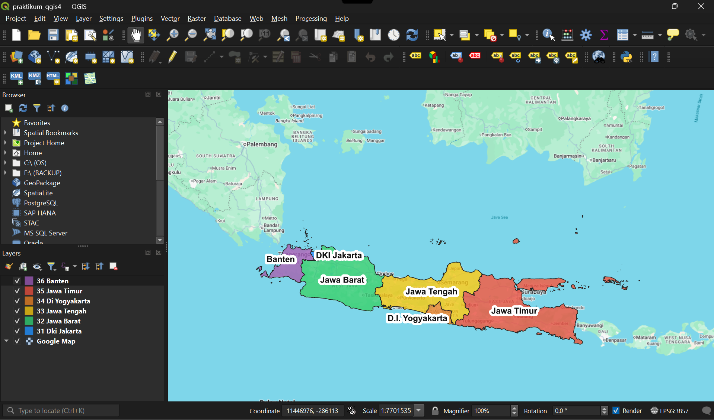
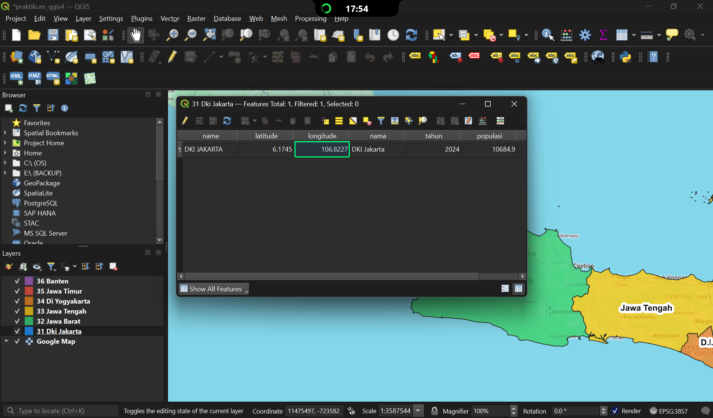
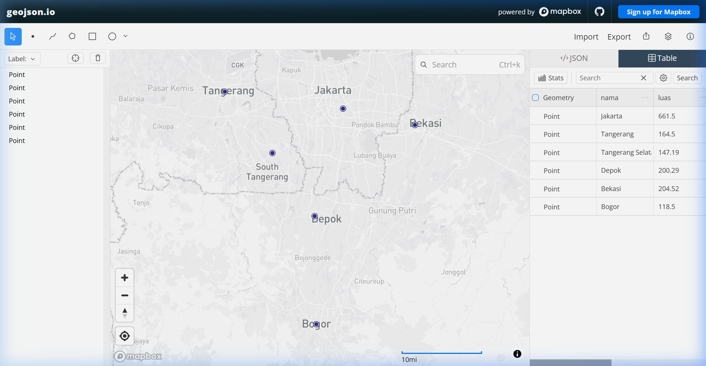

# Praktikum SIG 05: Aplikasi Quantum GIS 2 (Dataset GeoJSON & Data Non-Spasial)

Repositori ini berisi berkas hasil pengerjaan **Praktikum Sistem Informasi Geografis (SIG) - Modul 05** tentang pembuatan dokumen format GeoJSON, integrasi dataset GeoJSON ke dalam Quantum GIS (QGIS), ekspor ke format Shapefile, penambahan atribut non-spasial (luas, populasi 2024, dan GDP), serta pemetaan poligon tematik provinsi di Pulau Jawa (Praktikum Mandiri).

---

## 📁 Struktur Direktori Repositori

```text
github_repo_praktikum5/
├── README.md                           # Dokumentasi ringkas repositori GitHub
├── LAPORAN_PRAKTIKUM_SIG_05.md         # Laporan praktikum lengkap (Tugas Pendahuluan, Metode, & Pembahasan)
├── .gitignore                          # Berkas pengabaian file sementara
├── data/
│   ├── jabotabek.geojson               # Dataset GeoJSON 6 titik kota (Jakarta, Tangerang, Tangsel, Depok, Bekasi, Bogor)
│   ├── shapefile/                      # Berkas ESRI Shapefile hasil ekspor dari GeoJSON
│   │   ├── jabotabek.shp
│   │   ├── jabotabek.shx
│   │   ├── jabotabek.dbf
│   │   ├── jabotabek.prj
│   │   └── jabotabek.cpg
│   └── provinsi_jawa/                  # Dataset GeoJSON poligon 6 provinsi se-Pulau Jawa
│       ├── 31_dki_jakarta.geojson
│       ├── 32_jawa_barat.geojson
│       ├── 33_jawa_tengah.geojson
│       ├── 34_di_yogyakarta.geojson
│       ├── 35_jawa_timur.geojson
│       └── 36_banten.geojson
├── qgis_projects/
│   ├── praktikum_qgis2.qgz             # Proyek QGIS Praktikum 1.2 (Titik Jabodetabek + Google Maps)
│   └── praktikum_qgis4.qgz             # Proyek QGIS Praktikum Mandiri (Poligon Provinsi Jawa)
└── screenshots/                        # Tangkapan layar penuh (full window)
    ├── 1_geojson_io_table_view.png
    ├── 2_geojson_io_feature_properties.png
    ├── 3_qgis_jabotabek_full_window.png
    ├── 4_qgis_pulau_jawa_mandiri_full_window.png
    ├── 5_qgis_attribute_table_jabotabek_full.png
    └── 6_qgis_attribute_table_provinsi_jawa_full.png
```

---

## 📊 Dataset & Indikator Non-Spasial

### 1. Data Titik Wilayah Jabodetabek (Tahun 2024)
| No | Nama Kota | Koordinat [Long, Lat] | Luas ($km^2$) | Populasi 2024 (Ribu Jiwa) | Tahun | GDP (Miliar USD) |
|:--:|:---|:---:|:---:|:---:|:---:|:---:|
| 1 | **Jakarta** | [106.8456, -6.2088] | 661.50 | 10,684.90 | 2024 | 211.50 |
| 2 | **Tangerang** | [106.6319, -6.1783] | 164.50 | 1,927.82 | 2024 | 14.17 |
| 3 | **Tangerang Selatan** | [106.7179, -6.2889] | 147.19 | 1,429.52 | 2024 | 6.85 |
| 4 | **Depok** | [106.7942, -6.4025] | 200.29 | 2,163.64 | 2024 | 5.75 |
| 5 | **Bekasi** | [106.9756, -6.2383] | 204.52 | 2,528.13 | 2024 | 7.81 |
| 6 | **Bogor** | [106.7972, -6.5971] | 118.50 | 1,067.80 | 2024 | 3.74 |

### 2. Data Poligon 6 Provinsi di Pulau Jawa (Tahun 2024)
| Kode | Provinsi | Tahun | Populasi 2024 (Ribu Jiwa) | Luas Wilayah ($km^2$) | Warna Visualisasi |
|:--:|:---|:---:|:---:|:---:|:---:|
| **31** | **DKI Jakarta** | 2024 | 10,684.90 | 661.50 | Biru (*Dodger Blue*) |
| **32** | **Jawa Barat** | 2024 | 50,345.20 | 35,377.76 | Hijau (*Emerald*) |
| **33** | **Jawa Tengah** | 2024 | 37,892.30 | 32,800.69 | Kuning (*Sunflower*) |
| **34** | **D.I. Yogyakarta** | 2024 | 3,761.90 | 3,133.15 | Oranye (*Carrot*) |
| **35** | **Jawa Timur** | 2024 | 41,814.50 | 47,803.49 | Merah (*Alizarin*) |
| **36** | **Banten** | 2024 | 12,435.80 | 9,662.92 | Ungu (*Amethyst*) |

---

## 🖼️ Galeri Tangkapan Layar (Full Screen UI)

### 1. Peta Titik Jabodetabek di Quantum GIS (QGIS)


### 2. Attribute Table Layer Shapefile dengan Kolom GDP Baru (QGIS)


### 3. Peta Tematik Poligon Provinsi Se-Pulau Jawa (Praktikum Mandiri)


### 4. Attribute Table 6 Provinsi di Pulau Jawa


### 5. Tampilan Tabel di geojson.io


---

## 🚀 Panduan Membuka Proyek
1. Pastikan aplikasi **QGIS** (versi 3.x atau 4.x) telah terinstal.
2. Untuk melihat sebaran titik Jabodetabek: buka file `qgis_projects/praktikum_qgis2.qgz`.
3. Untuk melihat poligon tematik provinsi Jawa: buka file `qgis_projects/praktikum_qgis4.qgz`.
4. Seluruh layer dan koneksi basemap Google Maps sudah terkonfigurasi secara otomatis.
